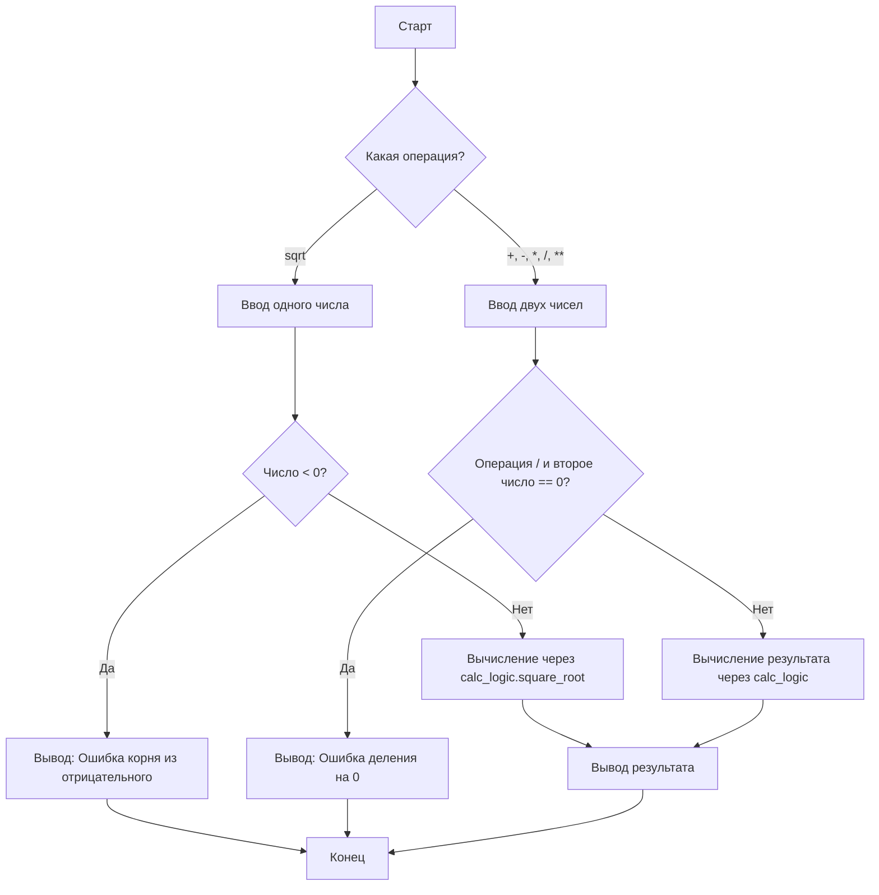

# Калькулятор

Консольная программа-калькулятор на Python 3.

## Возможности
- Базовые арифметические операции: сложение, вычитание, умножение, деление.
- Дополнительные операции: возведение в степень (`**`) и извлечение квадратного корня (`sqrt`).
- Разделение проекта на логические модули (`calc_logic.py` и `main.py`).
- Полное документирование функций с помощью встроенных строк `Docstring`.
- Надежная обработка ошибок ввода данных (блокировка букв и спецсимволов).
- Безопасная обработка математических ошибок (деление на ноль, извлечение корня из отрицательного числа).

## Требования
- Python 3.10+
- ОС РЕДОС (или другой Linux)

## Установка и запуск

1. Клонируйте репозиторий (или скопируйте папку)
2. Создайте виртуальное окружение:
   ```bash
   python3 -m venv venv
   ```
3. Активируйте окружение:
   ```bash
   source venv/bin/activate
   ```
4. Запустите программу:
   ```bash
   python main.py
   ```

## Алгоритм работы

Ниже представлена блок-схема основной логики калькулятора:



## Автор
Владимир Макрушин, группа ПРЗ-23, 2026
