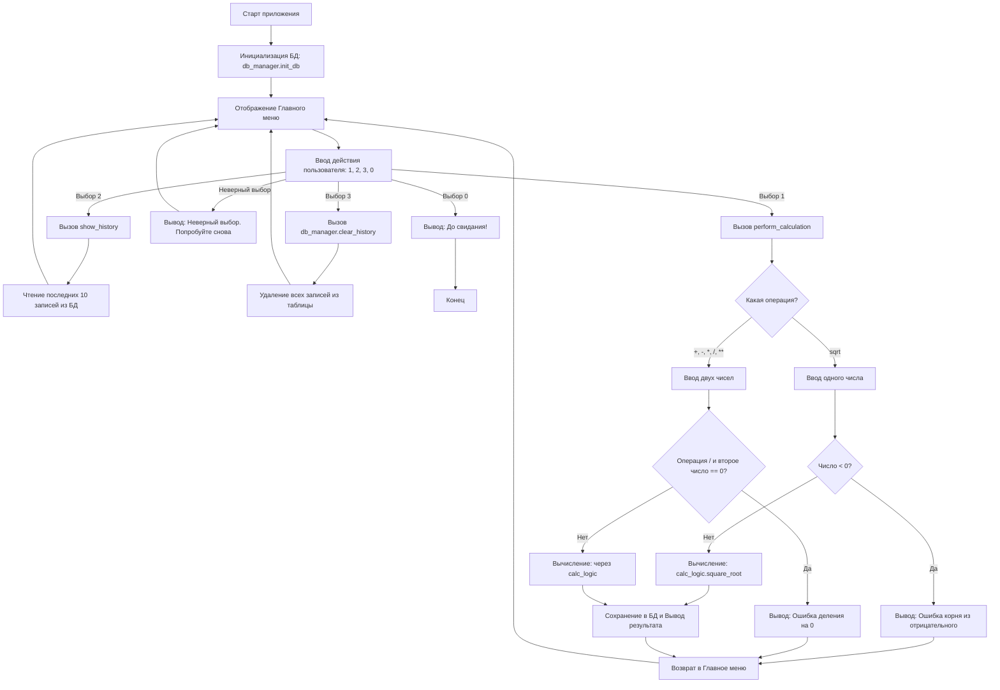

# Калькулятор

Консольная программа-калькулятор на Python 3.

## Возможности
- **Интерактивное меню:** Удобная навигация без перезапуска программы после каждого вычисления.
- **Базовые и расширенные операции:** Сложение, вычитание, умножение, деление, возведение в степень (`**`) и извлечение квадратного корня (`sqrt`).
- **Модульная архитектура:** Чёткое разделение на интерфейс (`main.py`), математическую логику (`calc_logic.py`) и управление данными (`db_manager.py`).
- **Постоянное хранение данных:** Автоматическая фиксация логов вычислений во встроенную базу данных SQLite (`history.db`).
- **Управление историей:** Просмотр последних 10 записей прямо из меню приложения или полная очистка таблицы данных.
- **Отказоустойчивость:** Безопасный перехват пользовательских ошибок ввода (букв), деления на ноль и извлечения корня из отрицательного числа.

## Требования
- Python 3.10+
- ОС РЕДОС (или другой Linux)

## Установка и запуск

1. Клонируйте репозиторий (или скопируйте папку)
2. Создайте виртуальное окружение:
   ```bash
   python3 -m venv venv
   ```
3. Активируйте окружение:
   ```bash
   source venv/bin/activate
   ```
4. Запустите программу:
   ```bash
   python main.py
   ```

## Алгоритм работы

Ниже представлена блок-схема основной логики калькулятора:



## Автор
Владимир Макрушин, группа ПРЗ-23, 2026
