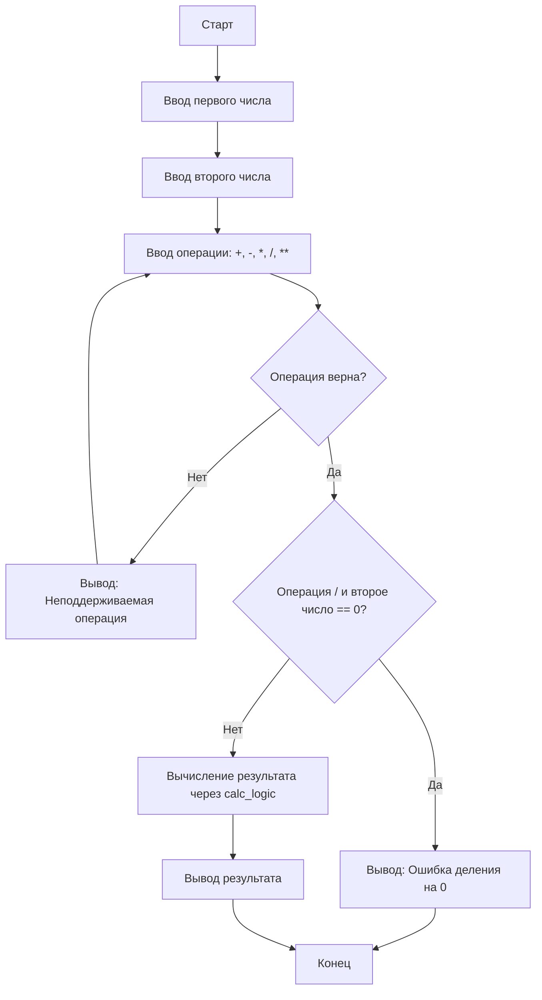

# Калькулятор

Консольная программа-калькулятор на Python 3.

## Возможности
- Сложение, вычитание, умножение, деление
- Обработка ошибок ввода
- Обработка деления на ноль

## Требования
- Python 3.10+
- ОС РЕДОС (или другой Linux)

## Установка и запуск

1. Клонируйте репозиторий (или скопируйте папку)
2. Создайте виртуальное окружение:
   ```bash
   python3 -m venv venv
   ```
3. Активируйте окружение:
   ```bash
   source venv/bin/activate
   ```
4. Запустите программу:
   ```bash
   python main.py
   ```

## Алгоритм работы

Ниже представлена блок-схема основной логики калькулятора:



## Автор
Владимир Макрушин, группа ПРЗ-23, 2026