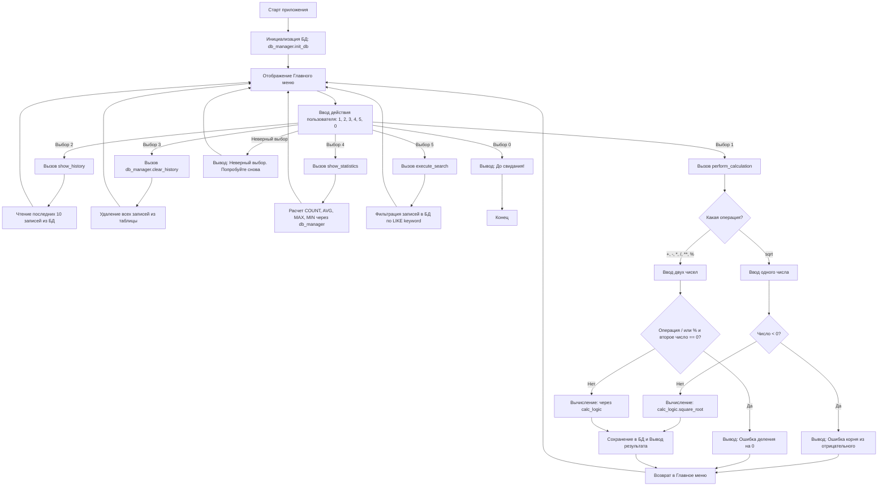

# Калькулятор

Консольная программа-калькулятор на Python 3.

## Возможности
- **Интерактивное меню:** Удобная навигация без перезапуска программы после каждого вычисления.
- **Базовые и расширенные операции:** Сложение, вычитание, умножение, деление, возведение в степень (`**`), извлечение квадратного корня (`sqrt`) вычисление остатка от деления (`%`).
- **Модульная архитектура:** Чёткое разделение на интерфейс (`main.py`), математическую логику (`calc_logic.py`) и управление данными (`db_manager.py`).
- **Постоянное хранение данных:** Автоматическая фиксация логов вычислений во встроенную базу данных SQLite (`history.db`).
- **Управление историей:** Просмотр последних 10 записей прямо из меню приложения или полная очистка таблицы данных.
- **Статистический модуль:** Вывод общего количества операций, среднего, максимального и минимального значений результатов.
- **Полнотекстовый поиск:** Возможность быстро найти записи в истории по числовому значению или знаку операции.
- **Отказоустойчивость:** Безопасный перехват пользовательских ошибок ввода (букв), деления на ноль и извлечения корня из отрицательного числа.

## Требования
- Python 3.10+
- ОС РЕДОС (или другой Linux)

## Установка и запуск

Проект снабжен автоматическими скриптами для быстрой настройки и запуска в Unix-среде:

1. **Клонируйте репозиторий** (или скопируйте папку с проектом).
2. **Сделайте скрипты исполняемыми** (выполняется один раз):
   ```bash
   chmod +x install.sh run.sh run_tests.sh
   ```
3. **Установите окружение и зависимости:**
   Скрипт автоматически создаст виртуальное окружение `venv`, обновит менеджер пакетов `pip`, установит все библиотеки из `requirements.txt` и инициализирует базу данных:
   ```bash
   ./install.sh
   ```
4. **Запустите калькулятор:**
   Скрипт автоматически активирует окружение, проверит зависимости и откроет интерактивное меню приложения:
   ```bash
   ./run.sh
   ```

## Тестирование

Для проверки корректности работы математических модулей и базы данных в проекте написаны Unit-тесты на фреймворке `pytest`.

Запуск тестов осуществляется одной командой с помощью автоматического скрипта:
```bash
./test.sh
```

### Что проверяют тесты:
* **calc_logic.py (Модульные тесты):** Проверка всех математических функций (сложение, вычитание, умножение, деление, остаток от деления), включая корректность округлений вещественных чисел и обработку исключений (деление на ноль).
* **db_manager.py (Интеграционные тесты):** Проверка сохранения одиночных и множественных записей в БД, корректность очистки истории вычислений, а также соблюдение лимитов вывода строк. Перед каждым тестом автоматически создается изолированная тестовая база данных `test_history.db`, которая удаляется после завершения проверок.

## Алгоритм работы

Ниже представлена блок-схема основной логики калькулятора:



## Автор
Владимир Макрушин, группа ПРЗ-23, 2026
